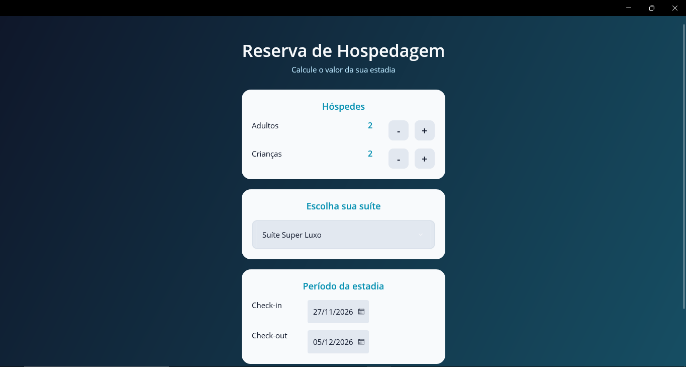
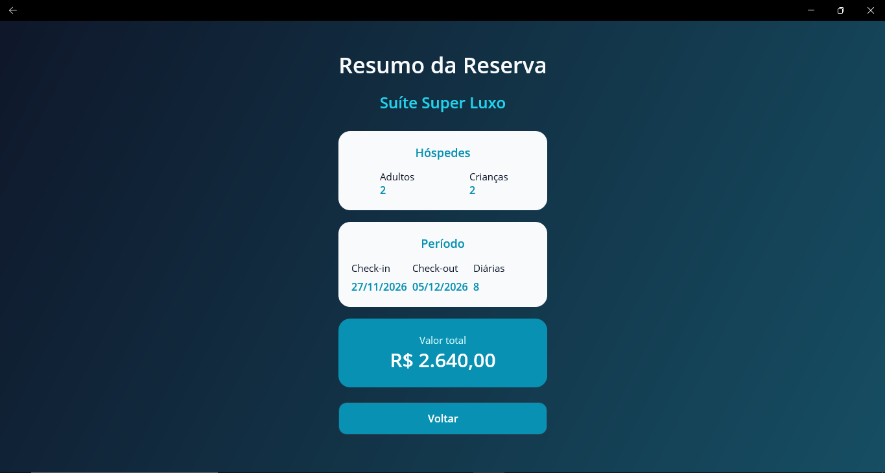
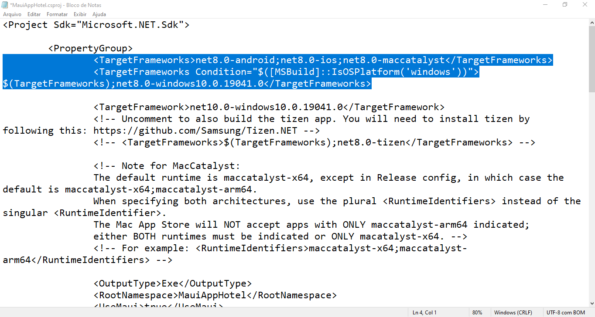
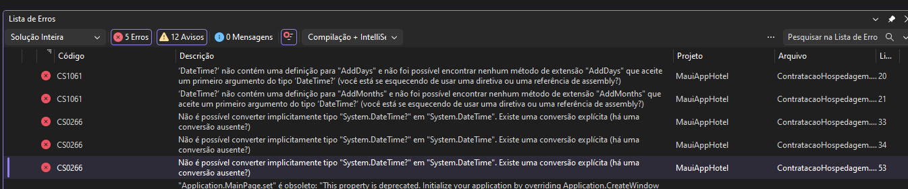
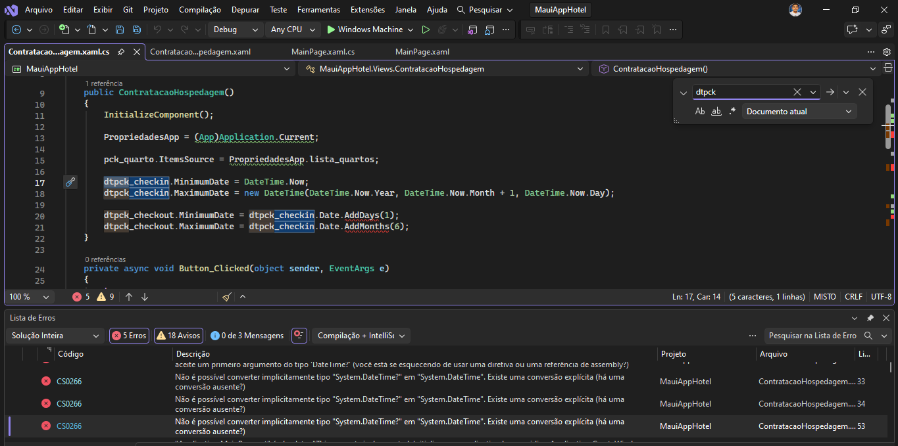
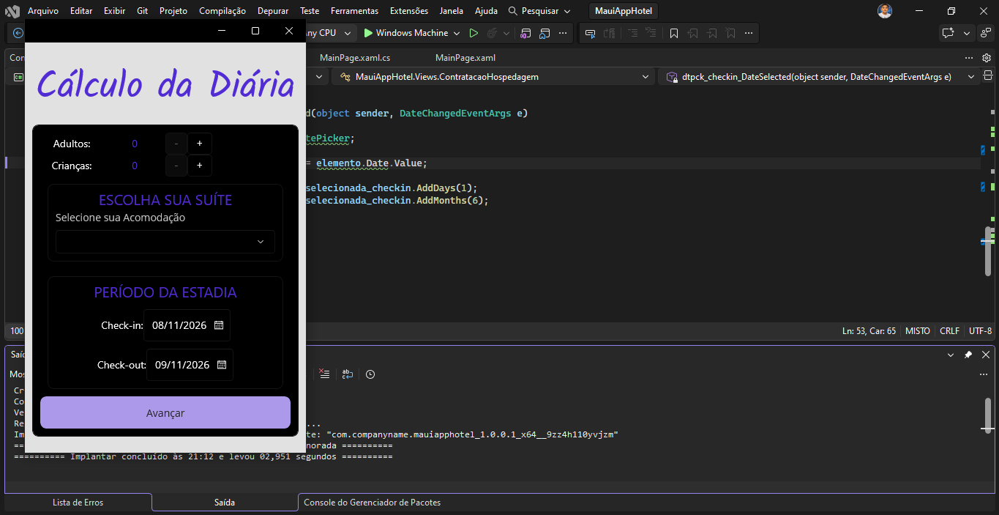
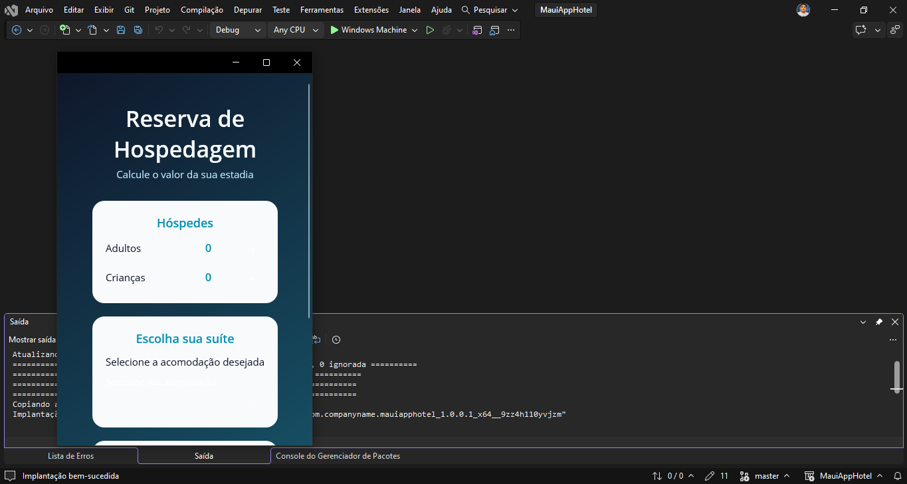
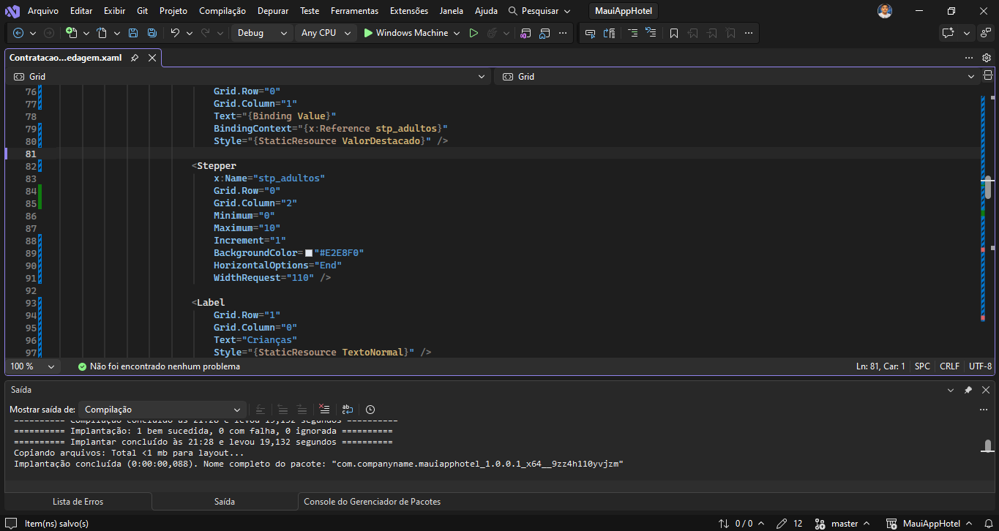
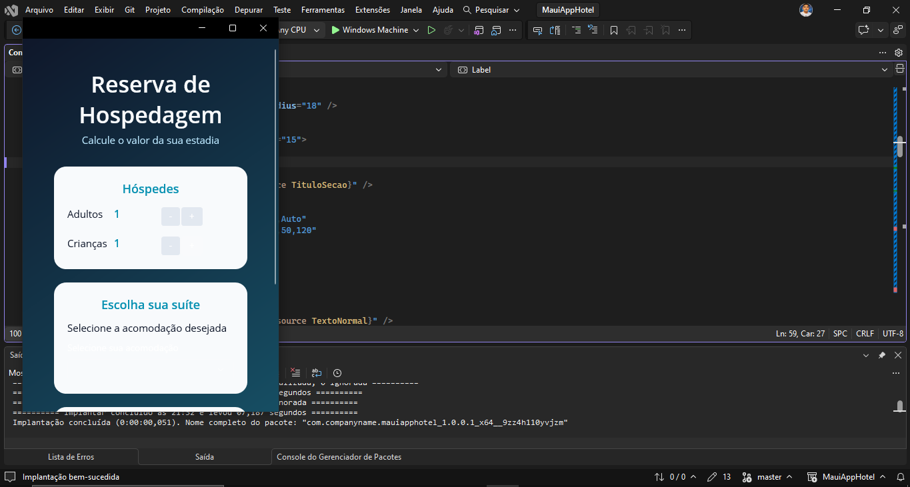
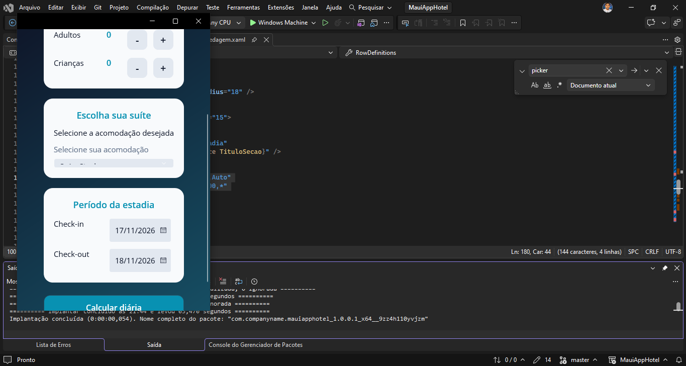

# AppHotel — Agenda 14

Projeto desenvolvido para a **Agenda 14 de Desenvolvimento de Sistemas II**, utilizando **C#**, **XAML** e **.NET MAUI**.

O projeto é baseado no AppHotel disponibilizado como material de estudo do curso e foi adaptado e personalizado durante a atividade.

Nesta versão foram realizadas alterações de compatibilidade, interface gráfica e interação com os componentes da aplicação.

---

## Resultado final

### Tela de reserva



### Resumo da hospedagem



---

## Objetivo

O AppHotel permite realizar uma simulação do valor de uma hospedagem informando:

- quantidade de adultos;
- quantidade de crianças;
- tipo de suíte;
- data de check-in;
- data de check-out.

Após o preenchimento, o aplicativo apresenta um resumo contendo os dados da reserva, a quantidade de diárias e o valor total calculado.

---

## Tecnologias utilizadas

- C#
- XAML
- .NET MAUI
- .NET 10
- Visual Studio
- Git
- GitHub

A versão atual do projeto está configurada para execução no Windows através do target:

```xml
<TargetFramework>net10.0-windows10.0.19041.0</TargetFramework>
```

---

## Alterações realizadas

### Migração para .NET 10

O projeto-base utilizava **.NET 8** e possuía targets para diferentes plataformas.

Para executar o projeto no ambiente utilizado durante a atividade, ele foi atualizado para **.NET 10 para Windows**.

Também foram removidas dependências antigas que não eram necessárias para a execução atual.

---

### Compatibilidade com o DatePicker do .NET 10

No .NET 10, a propriedade `Date` do `DatePicker` trabalha com `DateTime?`.

Por esse motivo, alguns trechos do código original precisaram ser adaptados.

Exemplo:

```csharp
dtpck_checkout.MinimumDate =
    dtpck_checkin.Date.Value.AddDays(1);
```

Também foram adaptadas as datas utilizadas para criar o objeto de hospedagem:

```csharp
DataCheckIn = dtpck_checkin.Date.Value,
DataCheckOut = dtpck_checkout.Date.Value,
```

---

## Nova interface

A interface gráfica foi reformulada mantendo as funcionalidades originais do projeto.

Entre as principais mudanças estão:

- nova paleta de cores;
- fundo em degradê;
- utilização de cards com cantos arredondados;
- reorganização dos elementos;
- nova hierarquia visual;
- substituição visual da fonte Kalam por Open Sans;
- novos estilos globais;
- melhoria da exibição do `Picker`;
- melhoria da exibição dos `DatePicker`;
- nova tela de resumo da hospedagem;
- destaque visual para o valor total.

As cores e estilos principais foram centralizados no arquivo `App.xaml`, facilitando alterações futuras no design.

---

## Controle de hóspedes

O projeto original utilizava o componente `Stepper`.

Durante a personalização, o controle foi substituído por botões próprios de incremento e decremento.

Exemplo:

```text
Adultos      2    -   +
Crianças     2    -   +
```

Essa alteração permitiu maior controle sobre a aparência dos componentes.

Foram criados estados visuais diferentes para:

- estado normal;
- passagem do mouse (`PointerOver`);
- botão pressionado (`Pressed`);
- botão desabilitado.

A quantidade é limitada entre **0 e 10 pessoas** para cada categoria.

---

## Seleção da suíte

As opções de hospedagem são representadas pela classe `Quarto`.

```csharp
public class Quarto
{
    public string Descricao { get; set; }
    public double ValorDiariaAdulto { get; set; }
    public double ValorDiariaCrianca { get; set; }
}
```

O aplicativo possui atualmente as seguintes opções:

- Suíte Super Luxo;
- Suíte Luxo;
- Suíte Single;
- Suíte Crise.

Os quartos são armazenados em uma:

```csharp
List<Quarto>
```

e apresentados ao usuário através de um `Picker`.

---

## Model de hospedagem

A classe `Hospedagem` reúne as informações utilizadas para calcular a reserva.

Entre suas propriedades estão:

```csharp
QuartoSelecionado
QntAdultos
QntCriancas
DataCheckIn
DataCheckOut
```

A quantidade de dias é calculada pela propriedade:

```csharp
public int Estadia
{
    get => DataCheckOut.Subtract(DataCheckIn).Days;
}
```

O valor total é calculado considerando:

```text
(valor dos adultos + valor das crianças)
                  ×
        quantidade de diárias
```

Essa lógica está encapsulada na propriedade `ValorTotal`.

---

## Validação das datas

O projeto utiliza componentes `DatePicker` para selecionar o período da hospedagem.

O check-out deve ocorrer depois do check-in.

Quando a data de entrada é alterada, os limites permitidos para a data de saída também são atualizados.

Exemplo:

```csharp
dtpck_checkout.MinimumDate =
    data_selecionada_checkin.AddDays(1);

dtpck_checkout.MaximumDate =
    data_selecionada_checkin.AddMonths(6);
```

---

## Navegação e BindingContext

Após clicar em **Calcular diária**, é criado um objeto `Hospedagem`.

```csharp
Hospedagem h = new Hospedagem
{
    QuartoSelecionado = (Quarto)pck_quarto.SelectedItem,
    QntAdultos = quantidadeAdultos,
    QntCriancas = quantidadeCriancas,
    DataCheckIn = dtpck_checkin.Date.Value,
    DataCheckOut = dtpck_checkout.Date.Value
};
```

O objeto é enviado para a tela de resumo utilizando `BindingContext`:

```csharp
await Navigation.PushAsync(
    new HospedagemContratada()
    {
        BindingContext = h
    }
);
```

A segunda tela utiliza os bindings do XAML para exibir automaticamente as informações da hospedagem.

---

## Estrutura principal

```text
MauiAppHotel/
│
├── Models/
│   ├── Hospedagem.cs
│   └── Quarto.cs
│
├── Views/
│   ├── ContratacaoHospedagem.xaml
│   ├── ContratacaoHospedagem.xaml.cs
│   ├── HospedagemContratada.xaml
│   └── HospedagemContratada.xaml.cs
│
├── Resources/
├── App.xaml
├── App.xaml.cs
├── MauiProgram.cs
└── MauiAppHotel.csproj

screenshots/
```

---

## Evolução durante a atividade

Além das telas finais, foram registradas várias etapas do desenvolvimento.

### Adaptação para .NET 10



### Erros encontrados após a migração



### Correção relacionada às datas



### Primeira execução do projeto original



### Início da revisão visual



### Ajustes de interface



### Ajuste dos controles



### Ajuste do Picker



---

## Como executar

### Requisitos

- Windows 10 ou Windows 11;
- Visual Studio com suporte a desenvolvimento .NET MAUI;
- .NET 10 SDK;
- workload do .NET MAUI para Windows.

Clone o repositório:

```bash
git clone https://github.com/akioShaolin/MauiAppHotel.git
```

Entre na pasta:

```bash
cd MauiAppHotel
```

Abra:

```text
MauiAppHotel.sln
```

No Visual Studio, selecione:

```text
Windows Machine
```

e execute o projeto.

Caso o Windows impeça a implantação local do aplicativo, pode ser necessário habilitar o **Modo de Desenvolvedor** nas configurações do sistema.

---

## Conceitos trabalhados

Durante esta atividade foram utilizados e revisados conceitos como:

- Programação Orientada a Objetos;
- classes e objetos;
- propriedades;
- `get` e `set`;
- encapsulamento;
- listas de objetos com `List<T>`;
- BindingContext;
- Data Binding;
- navegação entre páginas;
- manipulação de eventos;
- DatePicker;
- Picker;
- Grid;
- Border;
- estilos XAML;
- estados visuais;
- tratamento de exceções;
- validação de dados;
- Git e GitHub.

---

## Projeto original

Este repositório é um **fork** do projeto AppHotel criado por **Tiago Antonio da Silva** e utilizado como material de estudo do curso.

Repositório original:

https://github.com/tiagotas/MauiAppHotel

Código-base utilizado na Agenda 14:

https://github.com/tiagotas/MauiAppHotel/tree/4e655cb68610572865b83fc420655601b1a5f1ff

As alterações apresentadas neste repositório foram realizadas para a atividade da **Agenda 14 de Desenvolvimento de Sistemas II**.

---

## Autor das modificações

**Pedro Akio Sakuma**

GitHub: [@akioShaolin](https://github.com/akioShaolin)